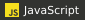
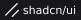
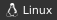

<picture>
  <source media="(max-width: 600px) and (prefers-color-scheme: dark)" srcset=".github/assets/banner-mobile-dark.svg">
  <source media="(max-width: 600px)" srcset=".github/assets/banner-mobile-light.svg">
  <source media="(prefers-color-scheme: dark)" srcset=".github/assets/banner-dark.svg">
  
</picture>

[shaduwi.nl](https://shaduwi.nl/) · [LinkedIn](https://linkedin.com/in/jimmy-hoenderdaal)

Full-stack developer at [JustBetter](https://justbetter.nl), based in Alkmaar, NL. I work on websites, web apps and [Rapidez](https://rapidez.io/) / Magento storefronts. Mostly frontend, with Laravel and PHP on the backend.

## Stack

                    

## Recent contributions

<!-- ACTIVITY:START -->
- [Add Laravel 12 support](https://github.com/justbetter/statamic-images/pull/2) in [justbetter/statamic-images](https://github.com/justbetter/statamic-images)
- [Add supports to transition discrete](https://github.com/rapidez/blade-components/pull/43) in [rapidez/blade-components](https://github.com/rapidez/blade-components)
- [Visual changes to query builder](https://github.com/rapidez/statamic-query-builder/pull/30) in [rapidez/statamic-query-builder](https://github.com/rapidez/statamic-query-builder)
- [Playwright tests](https://github.com/rapidez/checkout-theme/pull/196) in [rapidez/checkout-theme](https://github.com/rapidez/checkout-theme)
- [Add vue-turbo-frame performance docs](https://github.com/rapidez/docs/pull/104) in [rapidez/docs](https://github.com/rapidez/docs)
<!-- ACTIVITY:END -->

[All merged PRs](https://github.com/pulls?q=is%3Apr+author%3AJimmyHoenderdaal+is%3Amerged+is%3Apublic)

## Outside work

I run a [homelab](https://shaduwi.nl/#work) with Docker and self-hosted services. I read mostly philosophy and sci-fi. [Reading log](https://shaduwi.nl/#books) / [Hardcover](https://hardcover.app/id/user/74968).
